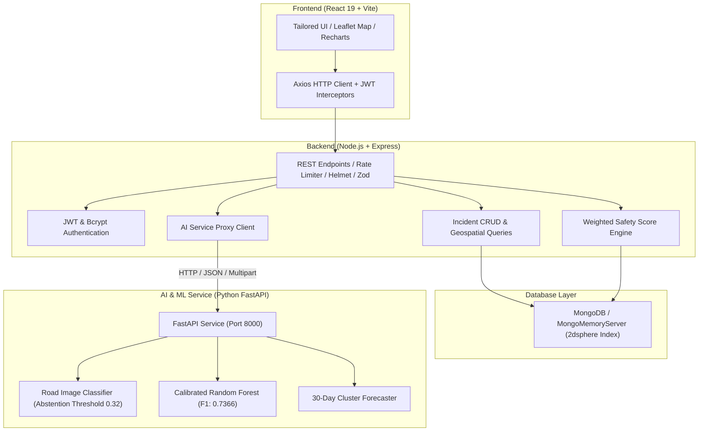

# RoadSafe AI — AI-Powered Road Accident Prevention Platform

RoadSafe AI is a full-stack, community-driven road safety reporting and artificial intelligence risk analysis platform. The platform enables citizens to report road hazards, review historical incidents, explore interactive geospatial heatmaps, classify road-condition imagery with computer vision, predict 30-day recurrence risks with calibrated machine learning, and calculate explainable road safety scores.

---

## 1. System Architecture



---

## 2. Technology Stack

- **Frontend**: React 19, Vite, React Router 7, Axios, Lucide Icons, Leaflet & React Leaflet, Recharts.
- **Backend**: Node.js, Express.js, MongoDB / Mongoose, JWT, bcryptjs, Multer, Zod, Helmet, Express Rate Limit.
- **AI & Machine Learning**: Python 3.13, FastAPI, Uvicorn, scikit-learn, Pandas, NumPy, Pillow, Joblib.
- **Maps & Visualization**: OpenStreetMap, Leaflet Heatmap radial overlay, SVG custom markers.

---

## 3. Quick Start (Windows)

### Prerequisites
- Node.js (v18+ or v24+)
- Python 3.10+ (with pip)
- MongoDB (Optional: The application automatically starts an embedded `mongodb-memory-server` fallback if a local `mongod` instance is not detected).

### Automated One-Click Startup
From the `RoadSafe-AI` root folder in PowerShell:
```powershell
.\start-all.ps1
```

---

## 4. Manual Step-by-Step Setup

### Step 1: Backend Setup
```powershell
cd server
npm install
npm test # Runs 29 automated tests across all 6 suites
npm start
```
Server starts on `http://localhost:5000`.

### Step 2: Python AI Service Setup
```powershell
cd ai-service
pip install -r requirements.txt
python train_risk_model.py # Generates dataset and trains calibrated ML model
pytest tests/ -v           # Runs 6 unit tests
uvicorn app.main:app --host 0.0.0.0 --port 8000 --reload
```
FastAPI docs available at `http://localhost:8000/docs`.

### Step 3: Frontend Client Setup
```powershell
cd client
npm install
npm run build # Tests production build
npm run dev
```
Client starts on `http://localhost:5173`.

---

## 5. Default Credentials & Roles

| Role | Email | Password | Access Level |
|---|---|---|---|
| **System Administrator** | `admin@roadsafe.ai` | `AdminSafe@2026!` | Moderation Queue, Analytics Telemetry, Status Certification |
| **Citizen Reporter** | `rohan.citizen@roadsafe.ai` | `seeded_dummy_hash_rohan` | Hazard Submissions, Personal Dashboard, Risk Map |

> [!NOTE]
> Public registration (`/register`) strictly assigns the `citizen` role. Administrative privilege escalation from registration payloads is blocked.

---

## 6. Machine Learning Pipeline Details

### A. Road Risk Prediction (`train_risk_model.py`)
- **Objective**: Estimate probability of road hazards causing high-risk incidents within a 30-day forward window.
- **Algorithm**: `RandomForestClassifier` with balanced class weights, calibrated using `CalibratedClassifierCV(method='sigmoid')`.
- **Validation**: Strict chronological 80/20 train-test split preventing data leakage.
- **Performance**:
  - **F1-Score**: 0.7366 (+0.0973 improvement over Logistic Regression baseline of 0.6393).
  - **Recall**: 80.32% (capturing true danger zones).
  - **Brier Score Loss**: 0.2217 (calibrated probability accuracy).

### B. Road-Condition Image Classification (`image_classifier.py`)
- **Categories**: `Pothole`, `Road crack`, `Surface damage`, `Waterlogging`, `Clear road`, `Uncertain`.
- **Features Extracted**: Laplacian edge density, localized dark depression ratio, specular reflection sheen, texture variance.
- **Abstention Threshold**: If highest predicted class probability is below 0.32 (32%), the model flags the output as `Uncertain` with `abstained = True`.

### C. Road Safety Score Formula (`safetyScoreEngine.js`)
$$\text{RiskIndex} = 100 \times (0.35 \times \text{IncidentRisk} + 0.25 \times \text{RoadDamageRisk} + 0.20 \times \text{LightingRisk} + 0.20 \times \text{JunctionRisk})$$
$$\text{SafetyScore} = 100 - \text{RiskIndex}$$
- **80–100**: Relatively Safer
- **60–79**: Moderate Concern
- **40–59**: Elevated Concern
- **0–39**: High Concern

---

## 7. REST API Endpoints

### Authentication
- `POST /api/auth/register` — Create citizen account
- `POST /api/auth/login` — Sign in and receive JWT token
- `GET /api/auth/me` — Authenticated profile

### Incidents
- `POST /api/incidents` — Submit hazard report (with image upload)
- `GET /api/incidents` — List incidents (filters: `category`, `severity`, `status`, `lat`, `lng`, `radiusKm`)
- `GET /api/incidents/mine` — Current user's reported hazards
- `GET /api/incidents/:id` — Details with audit trail
- `PATCH /api/incidents/:id/status` — Admin moderation with mandatory audit reason

### Analytics & AI
- `GET /api/analytics/summary` — Database KPI counts
- `GET /api/analytics/categories` — Category counts
- `GET /api/analytics/severities` — Severity counts
- `GET /api/analytics/hotspots` — Geospatial clusters
- `GET /api/analytics/safety-score?lat=...&lng=...` — 0-100 road safety rating
- `POST /api/ai/classify-image` — Computer vision road condition detection
- `POST /api/ai/predict-risk` — 30-day ML risk prediction
- `GET /api/ai/hotspots` — Projected future hotspot clusters

---

## 8. Verification & Test Commands

1. **Backend Integration Tests**:
   ```powershell
   npm test --prefix server
   ```
   *Result*: 6 test suites passed, 29 tests passed.

2. **AI Inference Unit Tests**:
   ```powershell
   pytest ai-service/tests -v
   ```
   *Result*: 6 unit tests passed.

3. **Frontend Production Build**:
   ```powershell
   npm run build --prefix client
   ```
   *Result*: Clean compilation into `client/dist`.
